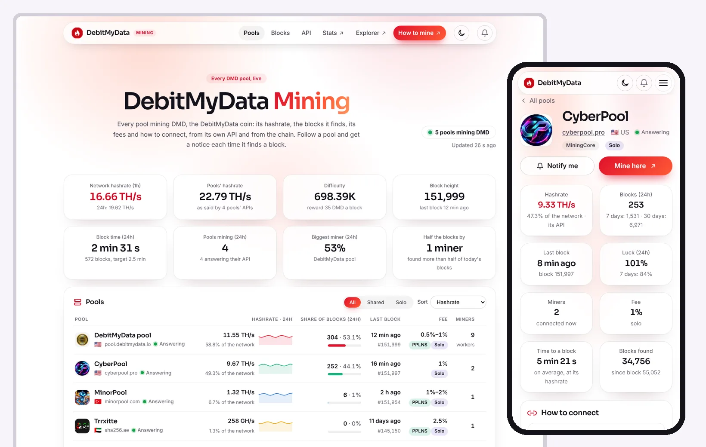

# DMD Mining

Every pool mining DMD (the DebitMyData coin), live:
**[mining.debitmydata.io](https://mining.debitmydata.io)**.

<p align="center">
<picture>
  <source media="(prefers-color-scheme: dark)" srcset="docs/images/mining-devices-dark.webp">
  
</picture>
</p>

- **Every pool**, with its hashrate, miners, fees, payout schemes and status from its own API, and
  the blocks it found from the chain: over the last hour, day, week and month, its last block,
  its share of the blocks, its luck, and a chart of its last 24 hours.
- **A page for each pool** (`/pool/<slug>`): how to connect (each stratum address with its
  difficulty, the username and password, copied in one tap), its hashrate and blocks over 24
  hours, 7 days, 30 days and a year, the blocks it found with their status and effort, its
  addresses, how often its API answered, whether its node is behind the chain.
- **The charts over time**: each pool's hashrate from the blocks it found (as the mempool explorer
  works it out: every block since block 1, every pool; together they make the network's), or as
  its own API says it, and the blocks each found, from 24 hours to everything.
- **Who finds the blocks**, and how concentrated mining is: how many miners together find half of
  them (a miner with more than half could rewrite recent blocks).
- **The latest blocks**, who found each and how long it took.
- **Notifications**: a notice on the device each time a pool it follows finds a block, even when
  the page is closed; optionally when a followed pool stops answering or its node falls behind,
  and when one miner finds more than half of the blocks.
- **An API**: the site's files, explained at [mining.debitmydata.io/api/](https://mining.debitmydata.io/api/).
- **An app**: it installs on phones and computers the same way as the pool's and DMD Stats.

## Where the figures come from

| What | From | How often |
| :-- | :-- | :-- |
| Who found each block | [DMD Stats](https://stats.debitmydata.io/api/) (`blocks.json`, `dmd-blocks.csv`), which reads every block from its own node and names its miner from DebitMyData's pool list | every 20 seconds; every block once at the start, then every 6 hours |
| The pools: names, links, countries, how their blocks are known | [`pools-v2.json`](https://github.com/DebitMyData-PoW/mining-pools) (the same list as the mempool explorer, DMD Stats and the analytics site) | every hour |
| Each pool's API, stratum servers, fees, how to connect | [`pools-info.json`](https://github.com/DebitMyData-PoW/mining-pools#readme), next to it | every hour |
| The logos | [mining-pool-logos](https://github.com/DebitMyData-PoW/mining-pool-logos) | every hour |
| Each pool's hashrate, miners, fee, ports, its node's height, its blocks' status | the pool's own API: MiningCore (`/api/pools`, `/api/pools/<id>/blocks`) or YIIMP (`/api/currencies`, `/api/status`) | every minute (its blocks every 5 minutes) |

This server needs no DebitMyData node: DMD Stats has one. A pool without a public API (or with
another kind) shows what it found on the chain, and what `pools-info.json` says about it.

## Adding a pool

1. In [DebitMyData-PoW/mining-pools](https://github.com/DebitMyData-PoW/mining-pools), add it to
   `pools-v2.json` as before (the mempool explorer, DMD Stats and the analytics site see it too),
   and add an entry with its `id` in `pools-info.json` (its README explains each field). For a
   MiningCore pool, its API and its stratum hosts are enough:

   ```json
   {
     "id": 11,
     "website": "https://example-pool.com/dmd",
     "software": "MiningCore",
     "api": "https://example-pool.com/api",
     "hosts": ["example-pool.com"],
     "modes": [{ "label": "PPLNS", "api_id": "dmd" }]
   }
   ```

   Its `api_id` is the pool's id in `https://example-pool.com/api/pools`. Without `modes`, the
   site takes every DMD pool its API lists.
2. Its logo in [mining-pool-logos](https://github.com/DebitMyData-PoW/mining-pool-logos), named as
   its slug (its name's lowercase letters and digits: `Example Pool` is `examplepool.svg`).

The site shows it within the hour, or within a minute after `sudo dmd-mining-admin pools` (it
reads the list now).

## What you need

- **A small Ubuntu 24.04 server**: 1 vCPU and 1 GB of memory are enough (the installer adds a
  1 GB swap file), 25 GB of disk (Vultr: Cloud Compute, Regular Performance, the smallest one),
  in another city than the pool. SSH with your key.
- **DMD Stats 1.1.12 or later** on the stats server: it publishes `blocks.json`, which this site
  follows. Update it first.
- **A name in Cloudflare**: `mining.debitmydata.io`, an A record to the server's IP, **proxied**
  (orange cloud).
- **A Cloudflare origin certificate** for `*.debitmydata.io` and `debitmydata.io`: the one you
  already use on the other servers works.

## Install

1. **The server.** Log in as root with your key, then turn off password logins:

   ```
   printf 'PasswordAuthentication no\nKbdInteractiveAuthentication no\nPermitRootLogin prohibit-password\n' > /etc/ssh/sshd_config.d/00-keys-only.conf
   sshd -t && systemctl reload ssh
   apt-get update && apt-get -y upgrade && apt-get -y install git
   ```

2. **The certificate.** Paste the origin certificate, then its private key (Ctrl+O, Enter, Ctrl+X
   to save):

   ```
   mkdir -p /etc/ssl/cloudflare
   nano /etc/ssl/cloudflare/debitmydata.io.pem
   nano /etc/ssl/cloudflare/debitmydata.io.key
   chmod 600 /etc/ssl/cloudflare/debitmydata.io.key
   ```

3. **This repository, and the install** (a few minutes):

   ```
   git clone https://github.com/DebitMyData-PoW/debitmydata-mining.git /opt/debitmydata-mining
   /opt/debitmydata-mining/install.sh
   ```

   It asks two questions; Enter keeps the answer in brackets (`mining.debitmydata.io`, and
   `debitmydata.io` for the certificate's file names). At the end it prints what the service
   knows.

4. **Check.** `https://mining.debitmydata.io` shows the pools within a minute or two (the first
   time, it reads every block from DMD Stats). The pools' charts fill as the service follows them,
   minute by minute: a pool's 24-hour chart is full after a day.

## Commands

| Command | |
| :-- | :-- |
| `sudo dmd-mining-admin status` | The blocks it knows, when it last read the chain and the pools, each pool's API, the devices with notifications on |
| `sudo dmd-mining-admin pools` | Reads the pool list and the logos from GitHub now (else every hour) |
| `sudo dmd-mining-admin publish` | Writes the site's files now |
| `sudo dmd-mining-admin push-keys` | Shows the notifications' public key (makes the key if there is none) |
| `journalctl -u dmd-mining -f` | The service's log |
| `systemctl status dmd-mining nginx` | The services |

## Settings

`/etc/dmd-mining/mining.env` (after a change: `sudo systemctl restart dmd-mining`):

| Setting | Default | |
| :-- | :-- | :-- |
| `DMDM_SITE_URL` | `https://mining.debitmydata.io` | The site (only its pages may change notifications) |
| `DMDM_STATS_URL` | `https://stats.debitmydata.io` | Where the blocks come from |
| `DMDM_POOLS_URL` | `https://raw.githubusercontent.com/DebitMyData-PoW/mining-pools/master` | `pools-v2.json` and `pools-info.json` |
| `DMDM_LOGOS_URL` | `https://raw.githubusercontent.com/DebitMyData-PoW/mining-pool-logos/master` | The logos |
| `DMDM_EXPLORER_URL` | `https://mempool.debitmydata.io` | Where blocks and addresses link to |
| `DMDM_POLL_SECONDS` | `60` | Between two reads of the pools' APIs (30 at least) |
| `DMDM_CHAIN_SECONDS` | `20` | Between two reads of DMD Stats' blocks |
| `DMDM_CATALOG_SECONDS` | `3600` | Between two reads of the pool list |
| `DMDM_PUSH_SUBJECT` | `mailto:info@debitmydata.com` | Given to the browsers' push services, as they ask |
| `DMDM_PUSH_MAX_DEVICES` | `20000` | Devices with notifications on, at most |

## Updating

```
cd /opt/debitmydata-mining && git pull && ./install.sh
```

It keeps the settings, the database and the notifications' key.

## The figures

- **A pool's hashrate**: what its API says (MiningCore: `poolHashrate`; YIIMP: the coin's
  hashrate, shared and solo together). Pools count differently, so their total can be more than
  the network's.
- **From its blocks**: the work of the blocks a pool found (difficulty × 2^32 each) divided by
  the time, over a window (2 hours on the 24-hour chart, more on the longer ones). It is the
  only hashrate of a pool without an API, and the way to check the others'.
- **The network's hashrate**: the same, with every block.
- **Luck**: the blocks a pool found, divided by the blocks its hashrate (from its API, which must
  have answered at least half of that time) should have found at the difficulty of the time.
  Above 100%, it found more. **Effort** (MiningCore): the work a block took, against the work a
  block takes on average; under 100%, it was luckier.
- **Half the blocks by**: how many miners together found more than half of the blocks (the
  Nakamoto coefficient). 1 means one miner did.
- **A pool's node is behind** when its API says its node is more than 5 blocks behind the chain:
  its miners may be working on old blocks, and their blocks would be orphaned.

## The notifications

Anyone can turn them on, without an account, with a pool's bell (in the list, or on its page) or
the Notifications card. The server keeps each device's choices with its browser's subscription
(the push service's address and keys), and nothing else: no account, no email, no IP. Turning
them off removes both. Notices are encrypted for each device and signed with the server's key
(`/var/lib/dmd-mining/push/vapid.pem`, made by the installer): **keep it in your backups**, as a
new key means every device has to turn them on again.

| Notice | When |
| :-- | :-- |
| *CyberPool found a block* | Each block a followed pool finds (several since the last notice make one) |
| *CyberPool isn't answering*, *CyberPool's node is behind*, *CyberPool is back* | A followed pool's API doesn't answer for 10 minutes, or its node is more than 5 blocks behind for 10 minutes; and when it's over (on by default) |
| *One miner finds most blocks*, *Mining is spread out again* | A miner finds more than half of the last 144 blocks (6 hours), and when it's back under 45% (off by default) |

## The app

DMD Mining installs from the browser (`web/js/install.js`), like the pool and DMD Stats: a window
offers it on phones a moment after the page opens (and from the footer's "Get the app"), with the
browser's one-tap install where it has one, or the steps (iPhone: Share, Add to Home Screen). Its
icon is the DMD coin with a flame in the red badge (`tools/make-app-icons.py` makes the icons
again, from any DebitMyData app's: `flame`, `trophy`, `globe` or `hammer`).

For a Google Play version (Bubblewrap, package `io.debitmydata.mining`), once it is published:
add `{ "platform": "play", "id": "io.debitmydata.mining" }` to `related_applications` in
`web/manifest.json`, and `web/.well-known/assetlinks.json` with the Play app signing key's
SHA-256 fingerprint.

## Security

- The server holds **no keys and no coins**, and runs no node.
- **Only Cloudflare reaches ports 80 and 443** (`cloudflare.sh`; run it again if Cloudflare changes
  its addresses). The only other open port is SSH.
- The service reads other sites only over **HTTPS, only public addresses** (an address in
  `pools-info.json` that points to this server or a private network is refused), with a size and
  a time limit, and no redirect to another site. A pool's API answers are figures only: every
  value is checked, and the pages show them as text.
- Nothing from GitHub runs here: the lists must read as lists, each logo as a plain picture (no
  script, no link out); anything else is left out, and the last good one stays. The logos are
  served with a policy that forbids anything in them but pictures.
- `/push` is limited to 30 requests a minute per visitor, takes only the browsers' push services as
  addresses to send to, and only requests from the site.
- The site runs only its own files (`config/nginx/csp.conf`): no other site's script, style, font
  or frame.

## If something is wrong

- **The blocks don't move** (`dmd-mining-admin status`: "Chain read from DMD Stats" long ago, and
  "blocks.json: HTTP 404" in the log): DMD Stats is older than 1.1.12. Update it.
- **"HTTP 403" from DMD Stats or a pool in the log**: Cloudflare's bot protection may be stopping
  this server. In Cloudflare, debitmydata.io, **Security**, **WAF**, add a custom rule that skips
  the bot checks for this server's IP.
- **A pool shows "Not answering"** while its site works: its API's address in `pools-info.json` may
  have changed. `dmd-mining-admin status` shows the error.

## Development

```
cd mining
python3 -m venv .venv && .venv/bin/pip install -e '.[test]' ruff
.venv/bin/pytest
.venv/bin/ruff check src tests && .venv/bin/ruff format --check src tests
```

The tests run the service against stand-ins for DMD Stats, GitHub and the pools' APIs
(`tests/conftest.py`).

## License

MIT. Fonts: SIL Open Font License (`web/fonts/OFL-Sora.txt`, `OFL-Inter.txt`,
`OFL-JetBrainsMono.txt`). ApexCharts: MIT (`web/vendor/LICENSE-apexcharts.txt`).
